

  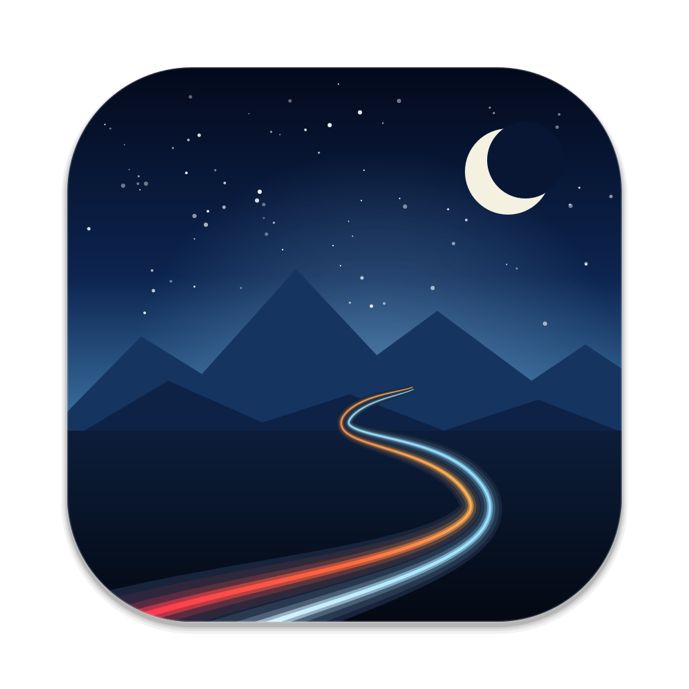

<h1 align="center">Car Driving World</h1>

<b>An endless, procedurally generated 3D driving game: mountain passes, country roads and motorways without a speed limit, through every season and every kind of weather.</b>

<b>Version 1.0</b> · <a href="https://github.com/nicks2d/Car-Driving-World/releases/latest">Download for macOS (Apple Silicon)</a> · <a href="CHANGELOG.md">Changelog</a>

Pick one of eight BMW M and Mercedes-AMG cars and drive into a world that never ends. Valleys, forests, rivers, lakes, dams, waterfalls and snow-capped peaks are generated as you drive, together with a road network of winding country roads, hairpin bends, bridges, tunnels, villages and long motorways with rest areas and traffic. Day turns into night, the moon goes through its phases, rain turns the roads into mirrors, and in a clear winter night the northern lights may appear. Or lean back in chill mode and let the car drive itself while the camera films it like a movie.

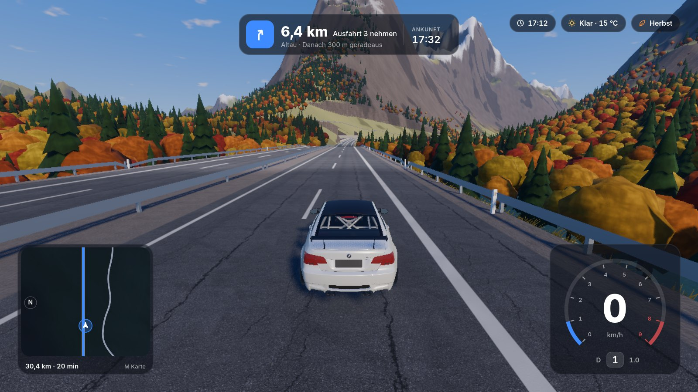

**Author:** Nick Aldinger ([@nicks2d](https://github.com/nicks2d))

> The interface is in German. The game is a desktop project built with Godot 4 and is developed and tested on macOS (Apple Silicon).

## Download

**[Car Driving World 1.0.0 for macOS](https://github.com/nicks2d/Car-Driving-World/releases/tag/v1.0.0)** (Apple Silicon, macOS 11 or later, about 130 MB)

1. Download `Car-Driving-World-1.0.0-macOS.zip` from the release, unzip it and drag **Car Driving World.app** into *Applications*.
2. **The app is not notarized by Apple**, so macOS will block it the first time. Right-click the app and choose **Open**, then **Open** again. If macOS still refuses: open *System Settings → Privacy & Security*, scroll down and click **Open Anyway**.
3. The very first start takes about a minute while the shaders are prepared for your Mac; after that it loads in a few seconds.

The download contains only the car models that may be shared (CC BY): the **BMW M3 (E30)**, **M3 GTS (E92)**, **M5 Competition (F90)** and **M4 CSL**, the Audi S3 in traffic and the petrol station. All other traffic is drawn with simple built-in shapes. Credits and licences are included in the download and in the game under *Garage → Credits*.

## Features

### An endless world
- **Generated as you drive:** the terrain is built in 256 m tiles around the car, with four levels of detail, and streamed in ahead of you in the direction you are driving, even at over 300 km/h
- **The same world every time:** everything comes from a single seed, so a mountain, a lake or a village is always in the same place
- **Mountains up to 1,900 m,** wide valleys, rivers that carve their own valleys, lakes, forests, bushes, rocks and grass that moves in the wind
- **Views to the horizon:** a coarse ring of terrain reaches 26 km into the distance, so there are always mountains on the horizon
- **Dams and reservoirs:** where a road crosses a narrow river valley, a concrete dam holds back a reservoir that fills the valley. The road runs along the crest, with a spillway, lamps and a lay-by with a view over the lake
- **Waterfalls** tumble down gullies into rocky pools, with spray, mist and the sound of the water
- **Landmark bridges:** long, high bridges become concrete arch bridges or suspension bridges with pylons and cables, visible from kilometres away and lit with red lamps at night
- **Life at the lakes:** bathing spots with a jetty and a kiosk, campsites with caravans, tents and a campfire at night, and boats drifting on the water
- **Villages** with houses, fences, street lamps and yellow town signs
- **Forests with three levels of detail:** detailed trees with branches up close, simpler trees further away and image-based trees in the distance, blending softly into each other, with groves, clearings, forest edges, reeds and stones along the shores
- **Rocks without repeating patterns,** grassy verges, worn tyre tracks and patched asphalt, and crests and dips rounded off like real roads, so the car stays on the ground even at 250 km/h

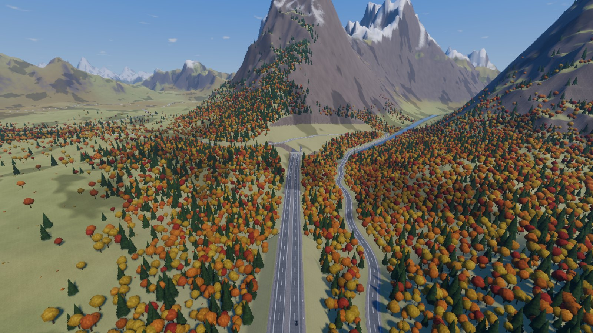

| | |
|---|---|
| 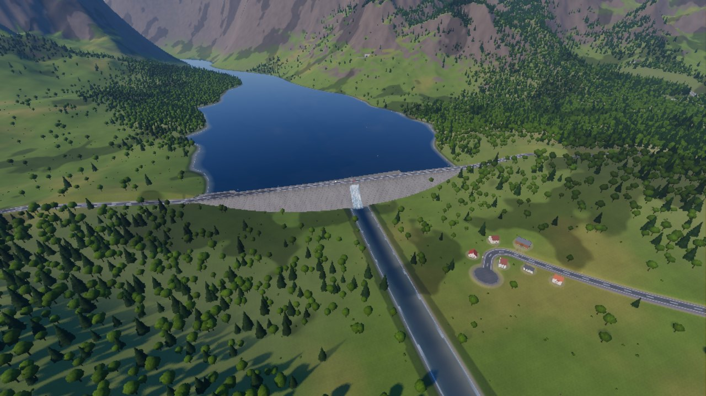 | 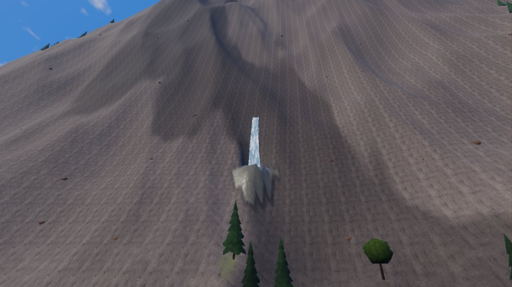 |
| 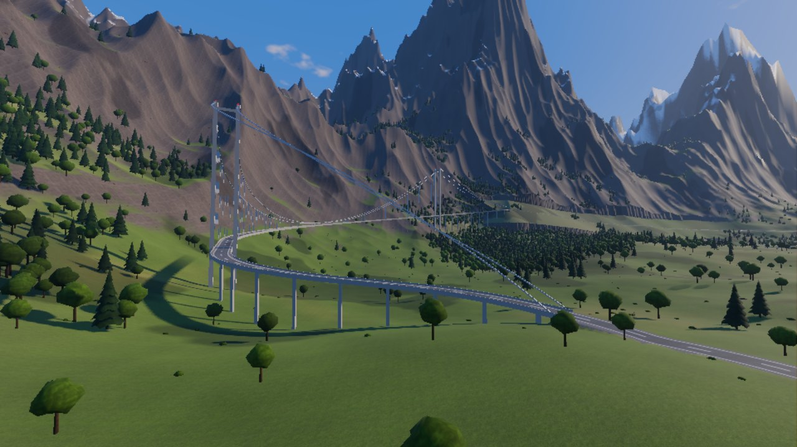 | 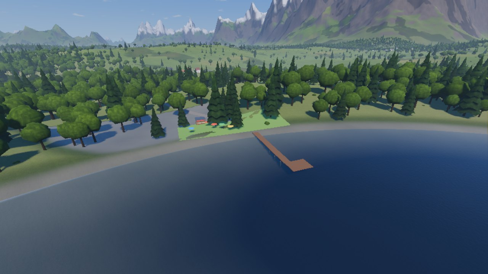 |

### Roads like the real thing
- **Country roads** connect villages across the landscape. They follow the valleys and climb mountains in hairpin bends, laid out like real roads with straights, circular arcs and banked curves
- **Motorways without a speed limit:** two lanes in each direction with a hard shoulder, a central crash barrier, reflector posts, junctions with deceleration and acceleration lanes, and blue gantry signs with invented German place names. About a fifth of all roads are motorways
- **Rest areas** about every 17–20 km with a petrol station, car and lorry parking, trees and benches
- **Speed limits** with real German traffic signs: 50 in villages, 70 or 50 before sharp bends, 80 in tunnels on country roads, and sections of 120, 100 or "100 when wet" on the motorway. The HUD shows the current limit
- **Bridges and viaducts** over rivers and valleys, **tunnels** through mountains with lights, concrete portals and an echo for the engine sound. Long tunnels have emergency call niches, escape route signs, jet fans, breakdown bays and a name at the portal
- **Right of way at junctions:** priority road signs, give-way and stop signs with road markings, and traffic that waits its turn
- **Viewpoints:** about one in five country roads has a lay-by at a beautiful spot, by a lake, on a mountain pass, at a dam or a waterfall

| | |
|---|---|
| 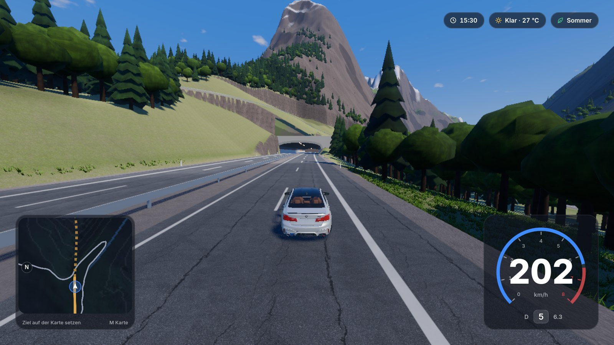 | 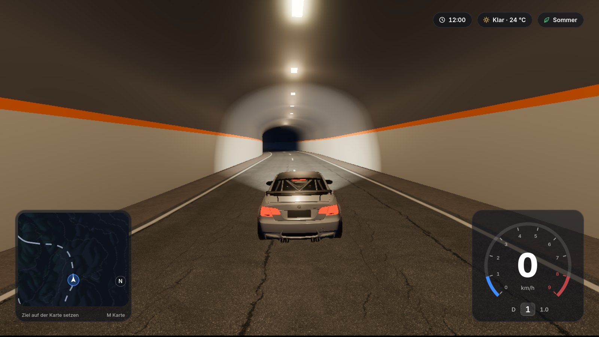 |
| 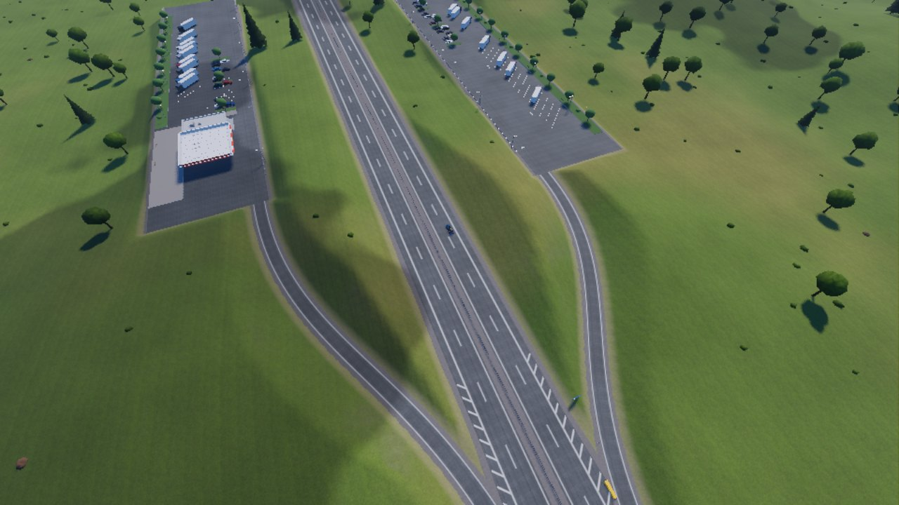 | 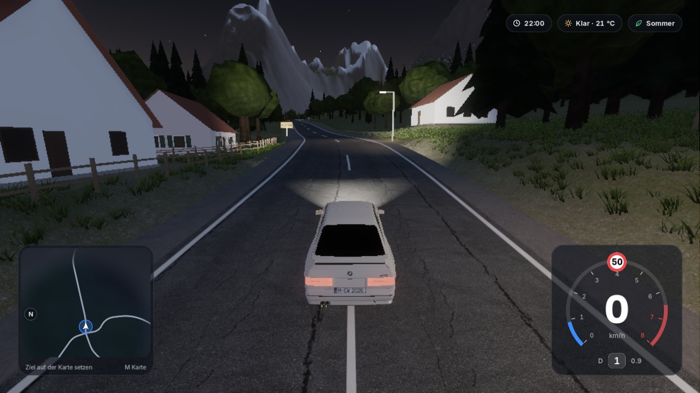 |

### Traffic
- **Cars and lorries** drive on every road, overtake on the motorway, use the on- and off-ramps and stop at rest areas
- **Traffic follows the clock:** quiet roads at night, rush hour in the morning and late afternoon with queues before the junctions
- They keep their distance, follow the speed limits, slow down in villages and on wet roads and use their indicators
- **Flash your headlights** at another car and it may accept a race to the next town sign or motorway exit

### Eight cars (four in the download)
| Car | Engine | Power | Drive | 0–100 km/h (in game) |
|---|---|---|---|---|
| BMW M3 (E30, 1986) | 2.3 l four-cylinder | 200 PS | Rear | 6.8 s |
| SL 65 AMG Black Series (R230, 2009) | 6.0 l V12, twin-turbo | 670 PS | Rear | 3.8 s |
| BMW M3 GTS (E92, 2011) | 4.4 l V8, naturally aspirated | 450 PS | Rear | 4.4 s |
| C 63 AMG Coupé Black Series (C204, 2013) | 6.2 l V8, naturally aspirated | 517 PS | Rear | 4.2 s |
| BMW M2 Competition (F87, 2018) | 3.0 l straight-six, twin-turbo | 410 PS | Rear | 4.2 s |
| BMW M5 Competition (F90, 2019) | 4.4 l V8, twin-turbo | 625 PS | All-wheel | 3.3 s |
| BMW M4 CSL (G82, 2023) | 3.0 l straight-six, twin-turbo | 550 PS | Rear | 3.7 s |
| BMW M5 (G90, 2025) | 4.4 l V8 hybrid | 727 PS | All-wheel | 3.5 s |

- Real torque curves, gear ratios and weights, an automatic gearbox with kickdown, power oversteer for the rear-wheel-drive cars and three grip levels (comfort, sport, drift)
- **Engine sound synthesised live** for each engine type, with turbo whistle and blow-off valve on the turbo cars, and pops and bangs with flames from the exhaust when you lift off
- Headlights, brake lights, indicators, hazard lights, horn, tyre marks, tyre smoke, spray from puddles and autumn leaves swirling behind the car
- **Cruise control with adaptive distance:** keeps your speed, follows the car in front and can take over the speed limits
- **Windows down** for more engine and wind noise, and your own **number plate** for each car
- **The garage:** pick a car, its paint, the time of day, the weather, the season and the moon phase. A **dyno** in the workshop measures power and torque and compares the last three cars
- **Three cameras** (`Tab`): a chase camera on a spring that leans into the corners, a **cockpit view** with a turning steering wheel, working instruments and live mirrors, and a first-person view at the windscreen. The body pitches and rolls, and crashes throw sparks
- **Rewind** the last 10 seconds by holding `Backspace` (traffic included), and a **2WD mode** for both M5 (`U`) for power drifts
- Raindrops running over paint and glass, snow on the roof and icy windows on cold mornings, indicators glowing in the real lamp glass and a welcome light when the engine starts

| | |
|---|---|
| 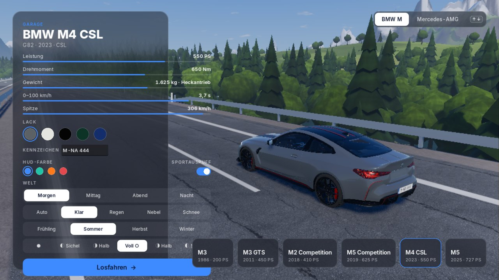 | 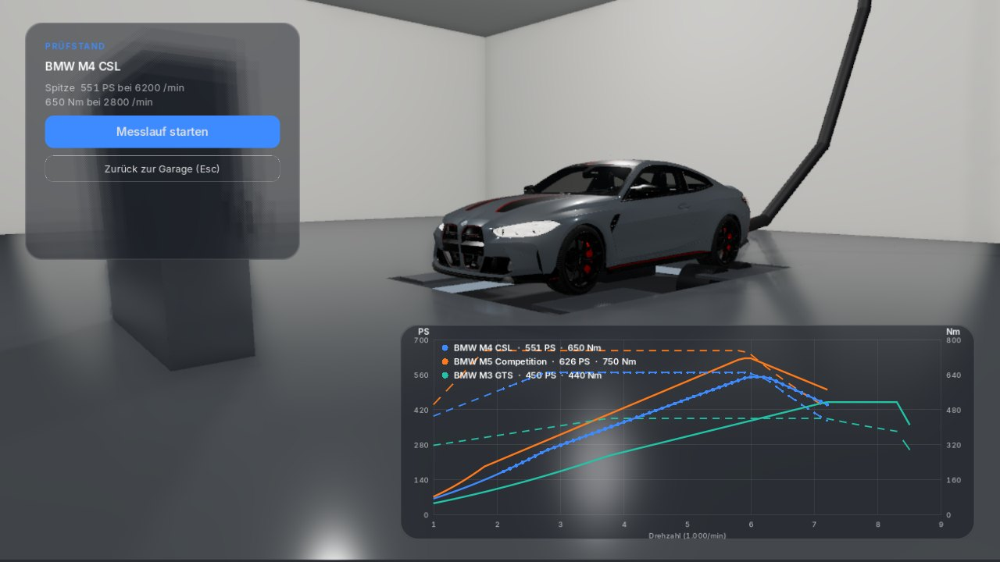 |

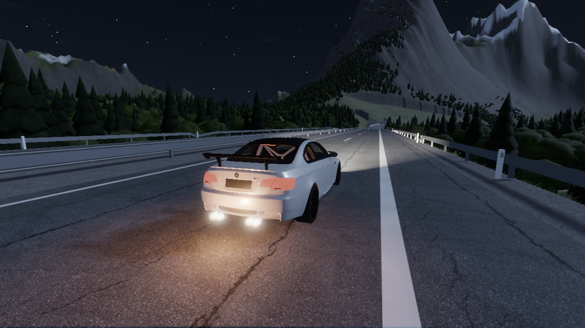

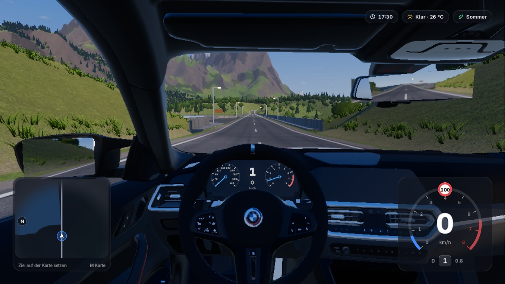

### Weather, seasons and the sky
- **Six kinds of weather:** clear, cloudy, rain, thunderstorm, fog and snow, changing smoothly every few minutes
- **Rain** makes the roads wet and reflective and reduces grip, and they dry off slowly afterwards. **Snow** covers the landscape and the road
- **Morning fog** settles in the valleys while the peaks stay clear
- **Four seasons:** fresh green in spring, red and golden forests in autumn, bare trees and snowy landscapes in winter
- **In the sky:** a rainbow when the rain stops, cloud shadows drifting across the mountains, the northern lights on some clear winter nights, **moon phases** over a 29.5-day cycle with matching moonlight, **shooting stars**, and darker, starrier nights far away from villages

| | |
|---|---|
| 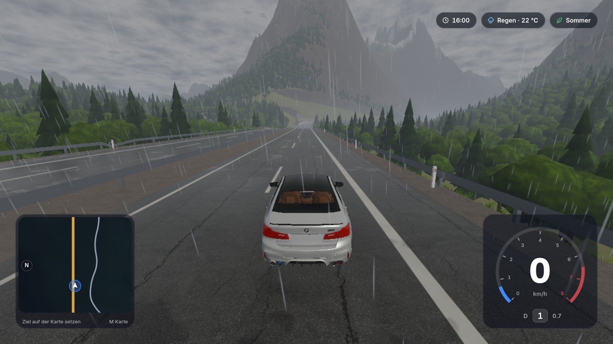 | 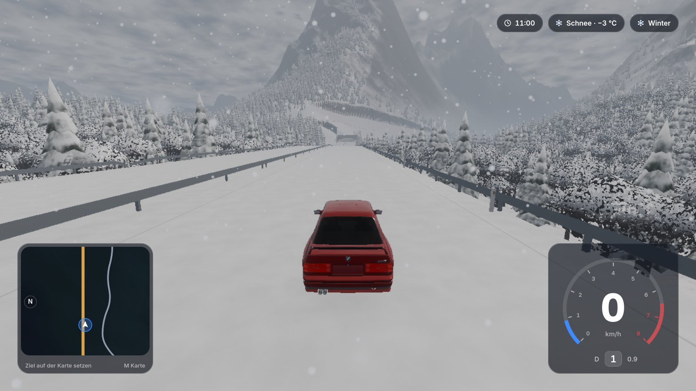 |
| 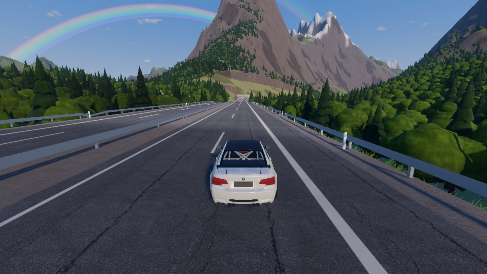 | 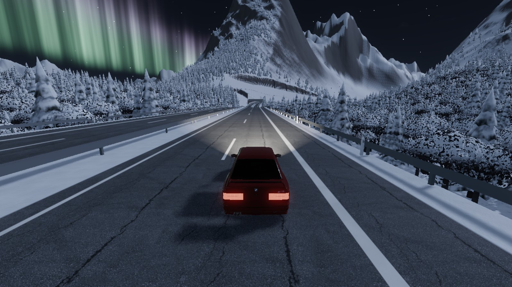 |

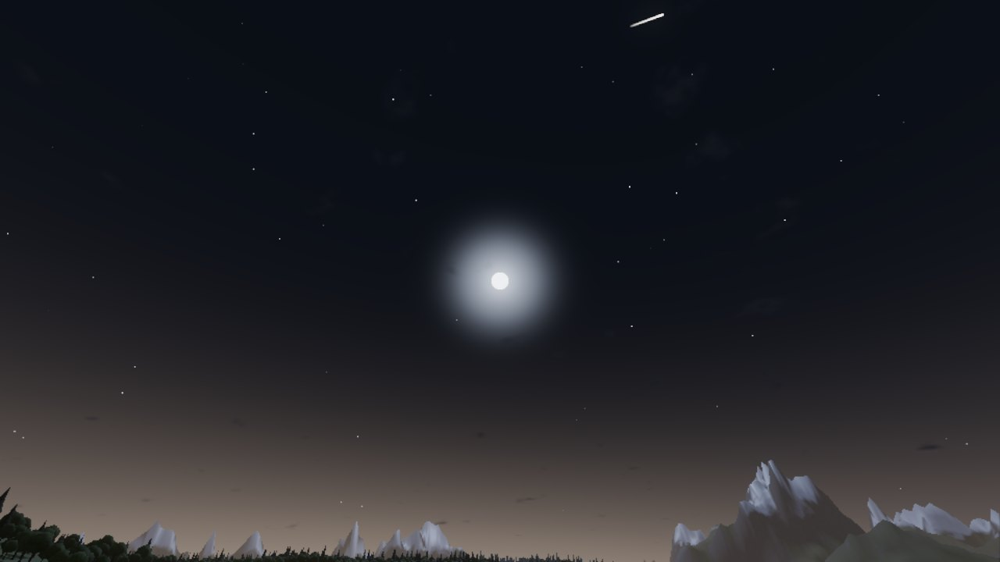

### Maps, collections, photo mode and chill mode
- **Minimap and full map:** click anywhere on the map to set a destination, and the route is planned across the road network, preferring the motorway when it is faster, with turn-by-turn directions and an arrival time
- **Explorer map:** the map only shows where you have been, about 300 m around every drive, plus everything you can actually see from a viewpoint (the terrain blocks the view). The rest lies under a soft fog, while the navigation still works. It can be switched off in the settings
- **Collections:** every place you drive through and every viewpoint you discover is collected in the garage with the date and your photo, with a message the first time
- **Photo mode:** pause the game, fly the camera around the car, set the focus, exposure, time of day and a filter, and save the picture
- **Chill mode:** the car drives on its own along scenic roads, keeping to the limits and the distance to other cars, while the camera cuts between helicopter, tracking, low front, bumper and roadside shots with soft cross-fades. Time and weather keep running, optionally faster. Any key ends it

| | |
|---|---|
| 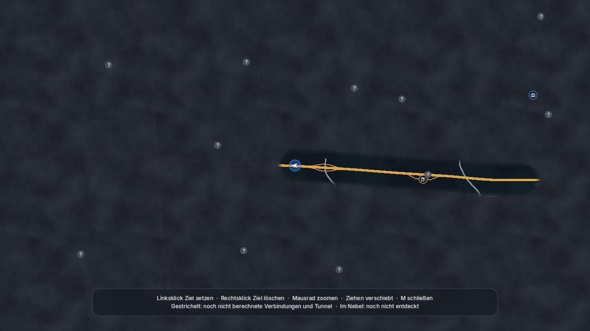 | 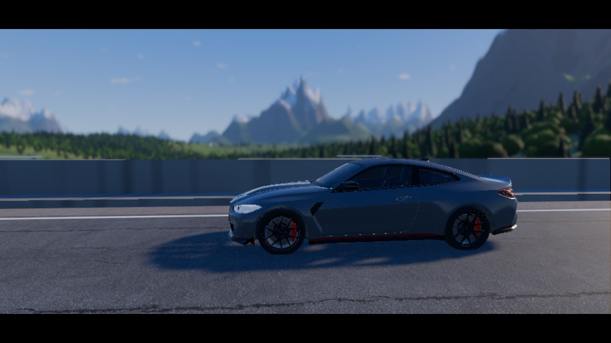 |

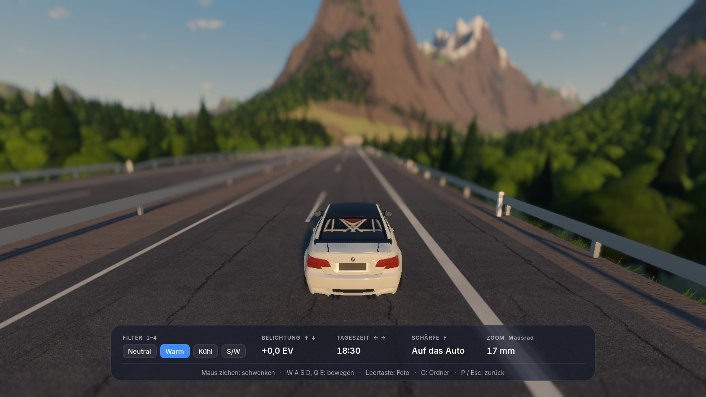

### Menus and settings
- A **loading screen** with pictures from the game, the real loading progress and tips for keys and features
- Soft animations in every menu, notifications that stack neatly, and **key hints** that show the right keys when you stop, at a rest area, at a viewpoint or on the dyno (can be switched off)
- A pause menu with five tabs: graphics (four quality presets and individual settings), display, controls (grip level, steering sensitivity, all keys can be remapped), audio and game, plus a *What's new* window after every update

## Controls

| Action | Key |
|---|---|
| Accelerate / brake and reverse | `W` / `S` |
| Steer | `A` / `D` |
| Handbrake | `Space` |
| Put the car back on its wheels | `R` |
| Pause menu (settings, chill mode) | `Esc` |
| Garage (car, paint, time, weather, season, moon) | `G` |
| Map | `M` (left-click sets a destination, right-click removes it) |
| Photo mode | `P` |
| Indicator left / right, hazard lights | `Q` / `E`, `X` |
| Horn / flash headlights | `H` / `F` |
| Cruise control on/off, set speed, distance | `N`, `+` / `−`, `B` |
| Headlights | `L` |
| Windows up/down | `V` |
| Weather / season | `F5` / `J` |
| Change paint / decals | `C` / `K` |
| Time-lapse | `T` |
| Camera (chase, cockpit, first person) | `Tab` |
| Rewind (hold) | `Backspace` |
| 2WD mode (M5 only, when stopped) | `U` |
| Frame rate | `F3` |

All keys except `Esc` can be changed in the settings.

## Running it locally

1. Install **[Godot 4.7](https://godotengine.org/download/)** (the standard version, not .NET).
2. Clone this repository and open `project.godot` in Godot, then press Play.
3. **The car models, the traffic models and the petrol station are not included** in this repository, because their licences do not allow it. Without them you drive a simple placeholder box with the same physics, and traffic and the petrol station are built from simple shapes. To add them, download the models from Sketchfab and follow [assets/models/README.md](assets/models/README.md) (in German).

The game was developed and tested on a MacBook Air with an Apple M4 chip, where it runs at about 60 frames per second or more on the "Hoch" (high) preset.

### Building the Mac app

The [download](#download) is the easiest way to play. To build the app yourself:

1. Add the models as described above (optional).
2. Install the Godot 4.7.2 export templates (in Godot: *Editor → Manage Export Templates*, or put `macos.zip` and `version.txt` from the official `.tpz` into `~/Library/Application Support/Godot/export_templates/4.7.2.stable/`).
3. Run `tools/build_mac_app.sh`. It exports the preset "macOS" from `export_presets.cfg`, keeps only the Apple Silicon code, names the app and signs it ad hoc. The result is `build/Car Driving World.app` with its own icon and splash screen (`--install` copies it to *Applications*).
4. `tools/build_mac_app.sh --download` builds the shareable version instead: the preset "macOS Download" leaves out every model with a non-commercial or no-derivatives licence, checks the result and packs a zip with credits and licences.

The app keeps its settings, maps and collections in the same folder as the game started from Godot, so nothing gets lost. Please do not share an app that contains the models with NC or ND licences.

## How it's built

- **[Godot 4.7](https://godotengine.org/)** with the Forward+ renderer and Jolt physics, everything written in **GDScript** and custom shaders, with no plug-ins
- **Procedural terrain:** layered noise with domain warping for valleys and mountain ranges, built in background threads, four levels of detail, and a mask that hides the distant horizon ring under every finished tile
- **Road network:** villages on a 1.2 km grid are connected by A* pathfinding across the terrain, which produces valley roads and hairpin bends on its own. The path is then turned into straights and circular arcs like in real road design, with a maximum gradient of 10 %, and the terrain is cut and filled around it. Tunnels replace roads that would cut too deep into a mountain, and holes are left in the terrain and its collision at the portals
- **Motorways** follow their own deterministic layout with curve radii of around 900 m and more and gradients of at most 4 %, and every road that crosses them is lifted onto a bridge or passes underneath
- **Dams** are found where a straight line between two villages crosses a river valley that is narrow enough. The reservoir is a flood fill up to just below the crest, and the road is routed in two parts so that it runs exactly along the crest
- **Vegetation** is modelled in code and drawn with MultiMesh in three levels of detail: detailed trees up close, about 150 triangles per tree further away and impostors (pictures of each tree from eight angles, baked when the game starts) in the distance, so a whole forest costs only a few draw calls
- **Weather** drives global shader parameters such as wetness and snow cover for the terrain, the roads and the trees. Valley fog is computed from the depth buffer along every view ray. The sky shader draws the sun, the moon with its phase, shooting stars, the rainbow and the northern lights
- **Traffic** moves kinematically along the roads with the Intelligent Driver Model for distances, and the traffic models were simplified to three levels of detail with a custom tool
- **Cars** are described by profiles with torque curves, gear ratios and all-wheel-drive split. The model loader splits wheels that come as one mesh, merges parts by material (from 1,213 to 33 draw calls for the M5 G90) and resizes the textures
- **Engine sound** is generated sample by sample from a table of ignition pulses for each engine type, plus turbo, blow-off valve, rev limiter and pops
- **Navigation** runs A* over a graph of villages and motorway nodes with travel time as the cost, and the map is drawn in tiles in the background. The explorer map stores what you have seen in small image tiles and computes the view from a viewpoint with line-of-sight rays across the terrain
- **Glass HUD, garage and app icon** were first designed as mockups and then built in Godot with the Inter typeface and icons drawn in code. The app icon is a hand-written SVG

### Testing

- Command-line test tools take a screenshot at any position, time of day, season, weather and moon phase, open the map, the garage or the photo mode, or let an autopilot (or chill mode) drive the roads and the motorway while measuring the frame rate
- Claude Code used these tools to check its own work: it started the game, looked at the screenshots, compared them with the design mockups and fixed what was wrong. All screenshots in this README were taken with them
- `tools/test.sh` runs an automatic test drive through every mode and menu and checks the log for errors, and a world checker scans large areas for roads in water, holes in tunnels and too sharp crests

## Made by

**Nick Aldinger** ([@nicks2d](https://github.com/nicks2d)) came up with the idea and directed the project: what to build, how it should look and feel, every new feature from the first car on a flat plane to motorways, dams and chill mode, the choice of cars, bug reports, testing and feedback.

The code was written with **[Claude](https://claude.ai)** by Anthropic as an AI pair programmer. Nick described each feature in plain language, Claude wrote, tested and refined the code, and the two iterated until it worked the way he wanted.

### Tools and connectors used

| Tool | What it was used for |
|---|---|
| [Claude Code](https://code.claude.com) (Anthropic) | Writing, testing and debugging all of the GDScript and shaders, milestone by milestone |
| [Godot MCP](https://github.com/Coding-Solo/godot-mcp) | Letting Claude Code start the game, read the debug output and fix errors on its own |
| [Claude](https://claude.ai) (Anthropic) | Planning the milestones, writing the prompts, finding the causes of bugs and preparing the car models |
| Claude design canvas | Designing the glass HUD, the garage and the notifications as mockups before building them |
| GitHub connector | Uploading and maintaining this repository |
| Claude memory | Keeping track of the project across separate chats |
| Built-in test tools | Automated screenshots and benchmarks, including the images in this README |

## Credits

- [Godot Engine](https://godotengine.org/) (MIT License)
- Font: [Inter](https://rsms.me/inter/) by Rasmus Andersson (SIL Open Font License)
- Textures from [Poly Haven](https://polyhaven.com/) (CC0): leafy grass, forest ground, rock face, snow, asphalt and gravel road
- App icon and splash screen: made for this project
- Models from Sketchfab, **not included** in this repository (only the CC BY models are part of the download) and modified in the game (scaled, wheels separated, parts hidden, merged or simplified, own materials):
  - "[[FREE] BMW M3 E30](https://sketchfab.com/3d-models/free-bmw-m3-e30-ac3c7013434e403e8faff87948caf422)" by [Martin Trafas](https://sketchfab.com/Bexxie), [CC BY 4.0](http://creativecommons.org/licenses/by/4.0/)
  - "[2011_bmw_e92_m3_gts](https://sketchfab.com/3d-models/2011-bmw-e92-m3-gts-5ef0b693916f413ab444fe46b4456a1a)" by [Car design](https://sketchfab.com/AnswerBlue38), [CC BY 4.0](http://creativecommons.org/licenses/by/4.0/)
  - "[Bmw M5 F90](https://sketchfab.com/3d-models/bmw-m5-f90-5478e978bd634337adc8e3dc413fbfa3)" by [RES1N](https://sketchfab.com/Resinnnn), [CC BY 4.0](http://creativecommons.org/licenses/by/4.0/)
  - "[BMW M4 CSL 2023](https://sketchfab.com/3d-models/bmw-m4-csl-2023-26d05968e63b4fc28205cbb9abb0ea41)" by Black Snow, [CC BY 4.0](http://creativecommons.org/licenses/by/4.0/)
  - "[BMW M2 Competition [Grays Widebody]](https://sketchfab.com/3d-models/bmw-m2-competition-grays-widebody-9c752f161d8c42bf85dd2a1ddbddd543)" by [blakebella](https://sketchfab.com/blakebella), [CC BY-NC-ND 4.0](http://creativecommons.org/licenses/by-nc-nd/4.0/)
  - "[2025 BMW M5 Sedan](https://sketchfab.com/3d-models/2025-bmw-m5-sedan-4ab34c43bada482b8e467be97ebaeba3)" by [Ddiaz Design](https://sketchfab.com/ddiaz-design), [CC BY-NC-SA 4.0](http://creativecommons.org/licenses/by-nc-sa/4.0/)
  - "[2009 Mercedes-Benz SL65 AMG Black Series](https://sketchfab.com/3d-models/2009-mercedes-benz-sl65-amg-black-series-768964f11377497eb1b3832972eb23e1)" by [Ddiaz Design](https://sketchfab.com/ddiaz-design), [CC BY-NC-SA 4.0](http://creativecommons.org/licenses/by-nc-sa/4.0/)
  - "[2013 Mercedes-Benz C63 AMG Coupe Black Series](https://sketchfab.com/3d-models/2013-mercedes-benz-c63-amg-coupe-black-series-1e043f59cf2545c88ba6c72fff1701ac)" by [Ddiaz Design](https://sketchfab.com/ddiaz-design), [CC BY-NC-SA 4.0](http://creativecommons.org/licenses/by-nc-sa/4.0/)
  - Traffic: "[2014 Audi S3 Limousine](https://sketchfab.com/3d-models/2014-audi-s3-limousine-33056acd771241638ebe74109ba2777a)" by tonielpro520, [CC BY 4.0](http://creativecommons.org/licenses/by/4.0/); "[2021 Honda Accord](https://sketchfab.com/3d-models/2021-honda-accord-e742636e46814de5af1568542e7c9bdb)" and "[2017 Lexus LC 500](https://sketchfab.com/3d-models/2017-lexus-lc-500-06f7ccfdf2aa4ef7afce64da59cacb16)" by [Ddiaz Design](https://sketchfab.com/ddiaz-design), [CC BY-NC-SA 4.0](http://creativecommons.org/licenses/by-nc-sa/4.0/); "[2005 Pontiac Aztek](https://sketchfab.com/3d-models/2005-pontiac-aztek-12b60d84bd044960881f72d079fabdc8)" by OUTPISTON, [CC BY-NC-SA 4.0](http://creativecommons.org/licenses/by-nc-sa/4.0/); "[2023 Volkswagen ID. Buzz GTX](https://sketchfab.com/3d-models/2023-volkswagen-id-buzz-gtx-3cc84dbea5b2495ba1f9468e8b4668d9)" by BloxBloger, [CC BY-NC 4.0](http://creativecommons.org/licenses/by-nc/4.0/)
  - Rest area: "[Small Red Gas Station](https://sketchfab.com/3d-models/small-red-gas-station-1a0feafb044148e585bfe588afe617b8)" by SmashedBones, [CC BY 4.0](http://creativecommons.org/licenses/by/4.0/) (brand logos replaced)

The screenshots only show models licensed under CC BY. BMW, Mercedes-Benz, AMG and the model names are trademarks of their owners. This is a non-commercial hobby project and is not affiliated with or endorsed by BMW AG or Mercedes-Benz Group AG.

## License

Copyright © 2026 Nick Aldinger. All rights reserved.

This project is published for viewing and demonstration only. You may not copy, modify or redistribute the code without written permission. See [LICENSE](LICENSE) for details.
