# Car Driving World

**An endless, procedurally generated 3D driving game: mountain passes, country roads and motorways without a speed limit, through every season and every kind of weather.**

Pick one of five BMWs and drive into a world that never ends. Valleys, forests, rivers, lakes and snow-capped peaks are generated as you drive, together with a road network of winding country roads, hairpin bends, bridges, tunnels and long motorways. Day turns into night, rain turns the roads into mirrors, and in a clear winter night the northern lights may appear.

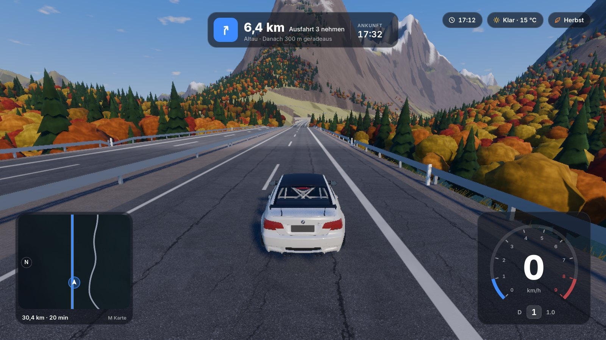

**Author:** Nick Aldinger ([@nicks2d](https://github.com/nicks2d))

> The interface is in German. The game is a desktop project built with Godot and has no browser version yet.

## Features

### An endless world
- **Generated as you drive:** the terrain is built in 256 m tiles around the car, with four levels of detail, and streamed in ahead of you in the direction you are driving, even at over 300 km/h
- **The same world every time:** everything comes from a single seed, so a mountain, a lake or a village is always in the same place
- **Mountains up to 1,900 m,** wide valleys, rivers that carve their own valleys, lakes, forests, bushes, rocks and grass that moves in the wind
- **Views to the horizon:** a coarse ring of terrain reaches 26 km into the distance, so there are always mountains on the horizon

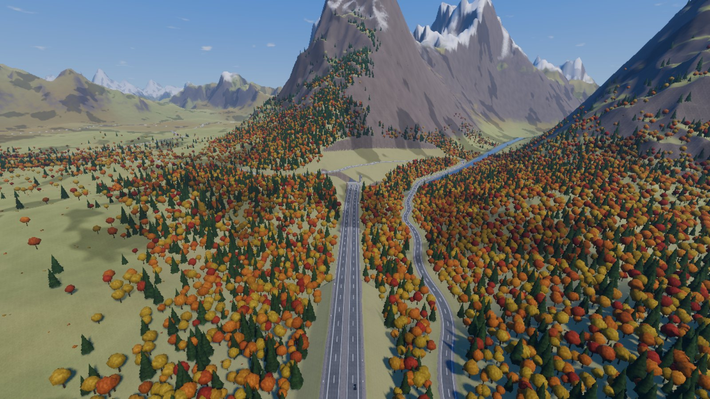

### Roads like the real thing
- **Country roads** connect villages across the landscape. They follow the valleys and climb mountains in hairpin bends, laid out like real roads with straights, circular arcs and banked curves
- **Motorways without a speed limit:** two lanes in each direction with a hard shoulder, a central crash barrier, reflector posts, junctions with on- and off-ramps, and blue gantry signs with invented German place names. About a fifth of all roads are motorways
- **Bridges and viaducts** over rivers and valleys, **tunnels** through mountains with lights, concrete portals and an echo for the engine sound
- Proper junctions, embankments, crash barriers on steep drops and in tight bends

| | |
|---|---|
| 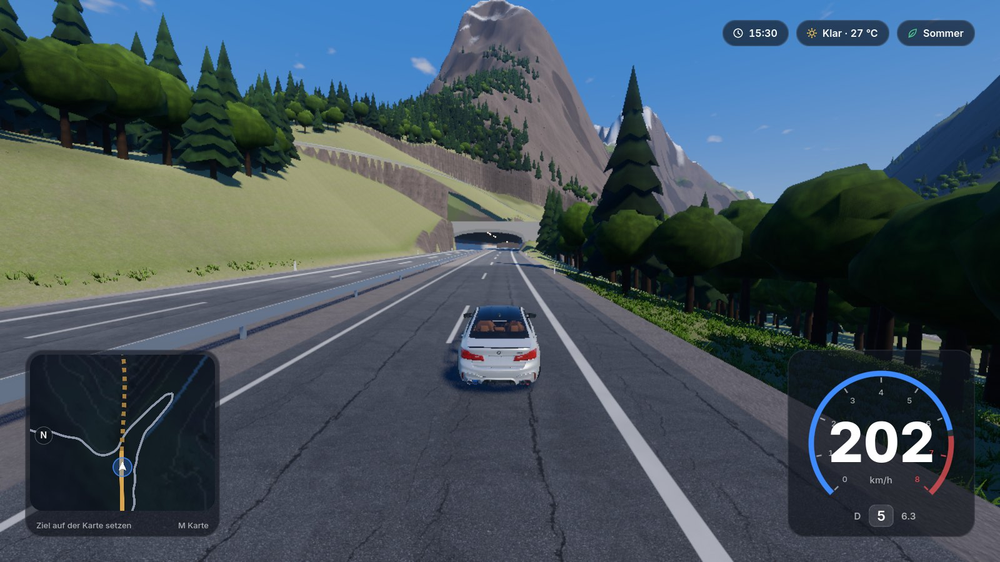 | 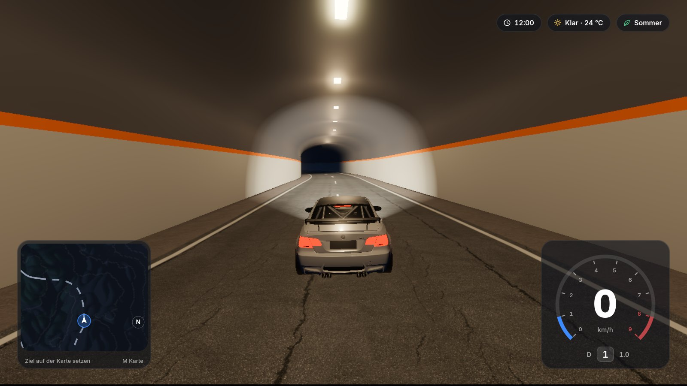 |

### Five BMWs
| Car | Engine | Power | Drive | 0–100 km/h (in game) |
|---|---|---|---|---|
| BMW M2 Competition (F87) | 3.0 l straight-six, twin-turbo | 410 PS | Rear | 4.2 s |
| BMW M3 (E30) | 2.3 l four-cylinder | 200 PS | Rear | 6.8 s |
| BMW M3 GTS (E92) | 4.4 l V8, naturally aspirated | 450 PS | Rear | 4.4 s |
| BMW M5 Competition (F90) | 4.4 l V8, twin-turbo | 625 PS | All-wheel | 3.3 s |
| BMW M5 (G90) | 4.4 l V8 hybrid | 727 PS | All-wheel | 3.5 s |

- Real torque curves, gear ratios and weights, an automatic gearbox with kickdown, and power oversteer for the rear-wheel-drive cars
- **Engine sound synthesised live** for each engine type, with turbo whistle and blow-off valve on the turbo cars, and pops and bangs with flames from the exhaust when you lift off
- Headlights that switch on at dusk, brake lights, tyre marks, tyre smoke, and spray on wet roads
- A garage in the middle of the world: pick a car, its paint, the time of day, the weather and the season

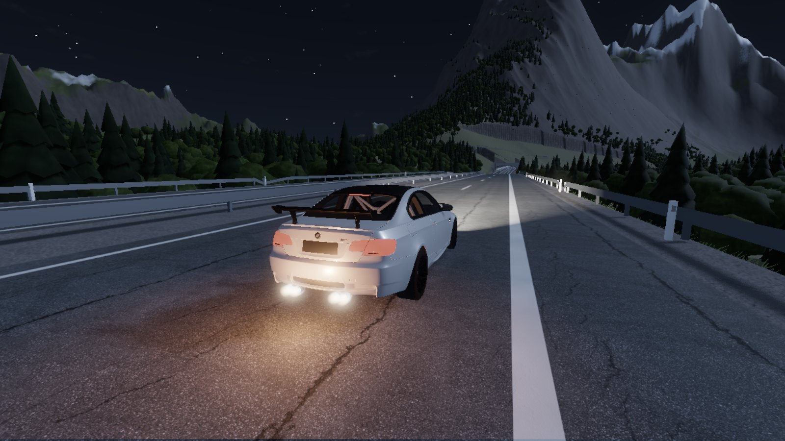

### Weather and seasons
- **Six kinds of weather:** clear, cloudy, rain, thunderstorm, fog and snow, changing smoothly every few minutes
- **Rain** makes the roads wet and reflective and reduces grip, and they dry off slowly afterwards. **Snow** covers the landscape and the road
- **Morning fog** settles in the valleys while the peaks stay clear
- **Four seasons:** fresh green in spring, red and golden forests in autumn, bare trees and snowy landscapes in winter
- **In the sky:** a rainbow when the rain stops, cloud shadows drifting across the mountains, and the northern lights on some clear winter nights

| | |
|---|---|
| 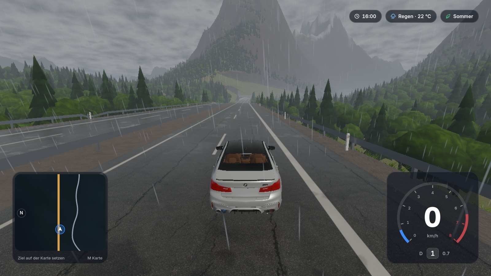 | 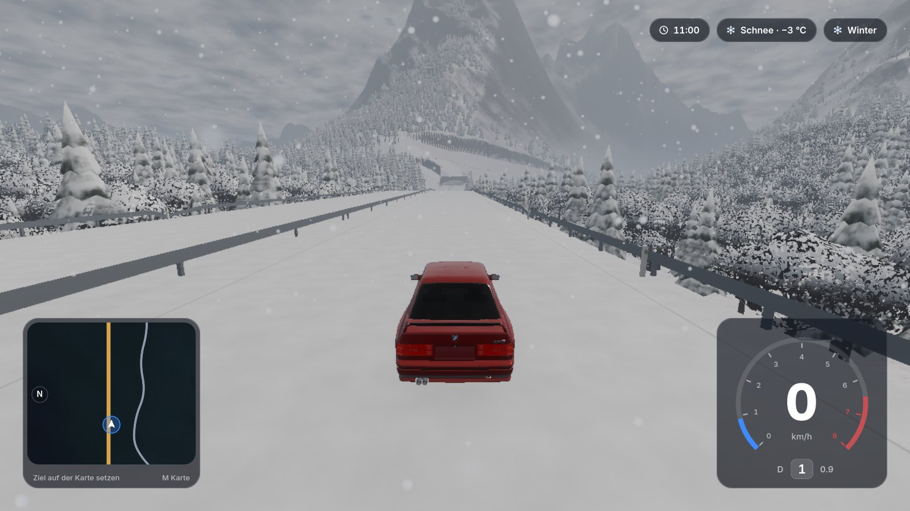 |
| 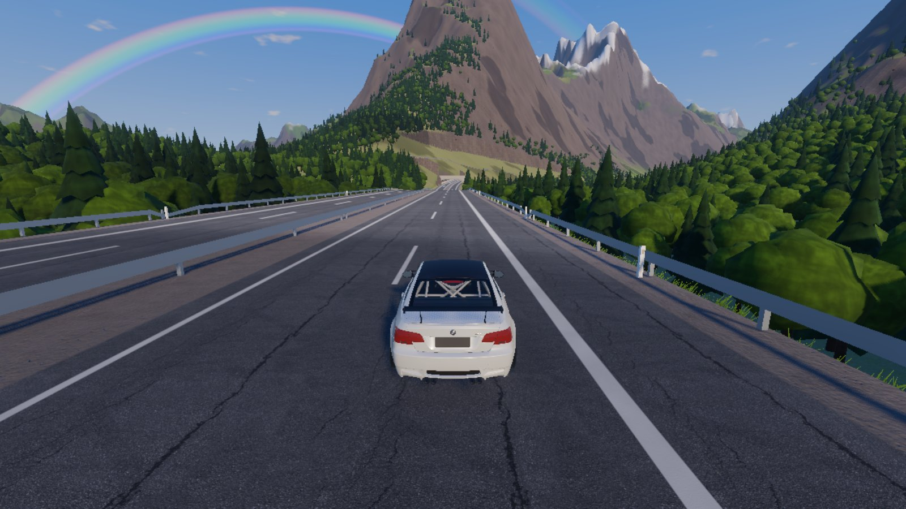 | 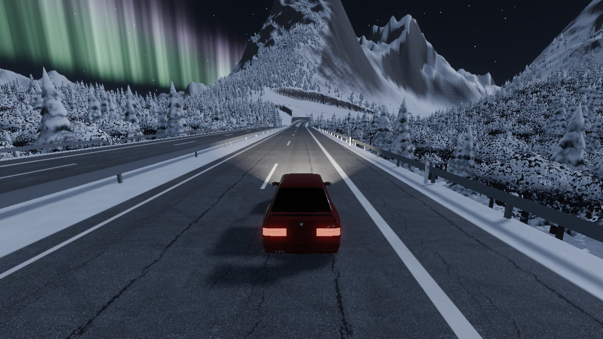 |

### Navigation, viewpoints and photo mode
- **Minimap and full map:** click anywhere on the map to set a destination, and the route is planned across the road network, preferring the motorway when it is faster, with turn-by-turn directions and an arrival time
- **Viewpoints:** about one in five country roads has a lay-by at a beautiful spot, by a lake, on a mountain pass or with a view over the valley. Stop there to discover it and collect them all
- **Photo mode:** pause the game, fly the camera around the car, set the focus, exposure, time of day and a filter, and save the picture

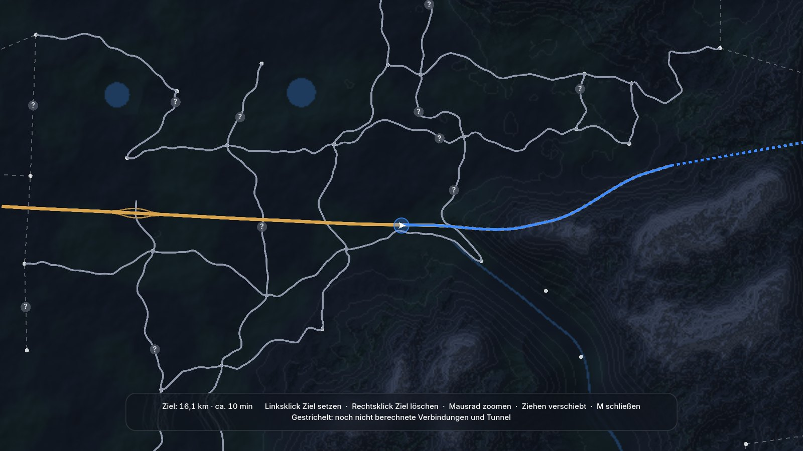

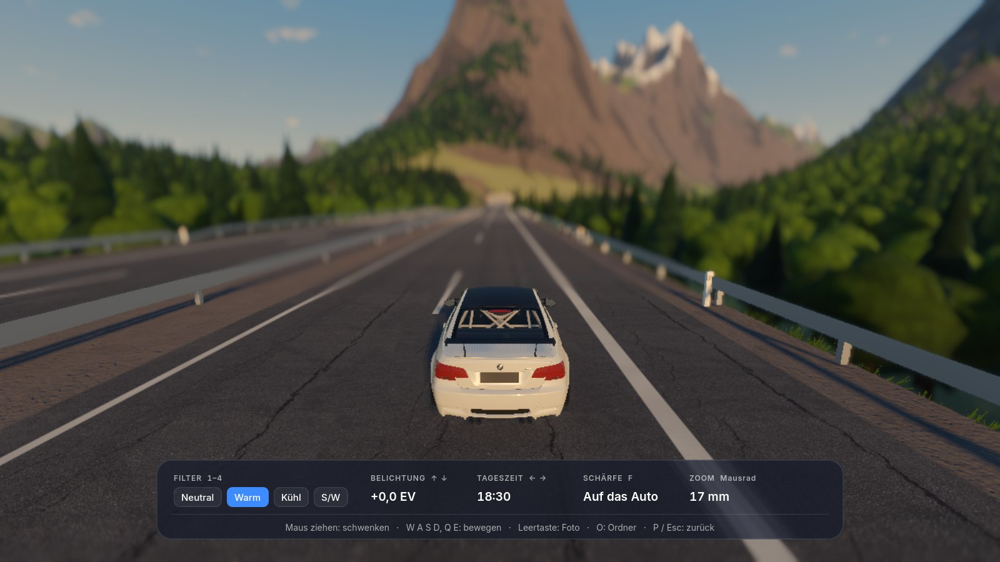

## Controls

| Action | Key |
|---|---|
| Accelerate / brake and reverse | `W` / `S` |
| Steer | `A` / `D` |
| Handbrake | `Space` |
| Put the car back on its wheels | `R` |
| Garage (car, paint, time, weather, season) | `G` |
| Map | `M` (left-click sets a destination, right-click removes it) |
| Photo mode | `P` |
| Weather / season | `F5` / `J` |
| Headlights | `L` |
| Change paint | `C` |
| Time-lapse | `T` |
| Frame rate | `F3` |

## Running it locally

1. Install **[Godot 4.7](https://godotengine.org/download/)** (the standard version, not .NET).
2. Clone this repository and open `project.godot` in Godot, then press Play.
3. **The car models are not included** in this repository, because their licences do not allow it. Without them you drive a simple placeholder box with the same physics. To add them, download the models from Sketchfab and follow [assets/models/README.md](assets/models/README.md) (in German).

The game was developed and tested on a MacBook Air with an Apple M4 chip, where it usually runs at 60 frames per second or more.

## How it's built

- **[Godot 4.7](https://godotengine.org/)** with the Forward+ renderer and Jolt physics, everything written in **GDScript** and custom shaders, with no plug-ins
- **Procedural terrain:** layered noise with domain warping for valleys and mountain ranges, built in background threads, four levels of detail, and a mask that hides the distant horizon ring under every finished tile
- **Road network:** villages on a 1.2 km grid are connected by A* pathfinding across the terrain, which produces valley roads and hairpin bends on its own. The path is then turned into straights and circular arcs like in real road design, with a maximum gradient of 10 %, and the terrain is cut and filled around it. Tunnels replace roads that would cut too deep into a mountain, and holes are left in the terrain and its collision at the portals
- **Motorways** follow their own deterministic layout with curve radii of around 900 m and more and gradients of at most 4 %, and every road that crosses them is lifted onto a bridge or passes underneath
- **Vegetation** is modelled in code (about 150 triangles per tree) and drawn with MultiMesh, so a whole forest costs only a few draw calls
- **Weather** drives global shader parameters such as wetness and snow cover for the terrain, the roads and the trees. Valley fog is computed from the depth buffer along every view ray
- **Cars** are described by profiles with torque curves, gear ratios and all-wheel-drive split. The model loader splits wheels that come as one mesh, merges parts by material (from 1,213 to 33 draw calls for the M5 G90) and resizes the textures
- **Engine sound** is generated sample by sample from a table of ignition pulses for each engine type, plus turbo, blow-off valve, rev limiter and pops
- **Navigation** runs A* over a graph of villages and motorway nodes with travel time as the cost, and the map is drawn in tiles in the background
- **Glass HUD and garage** were first designed as mockups and then built in Godot with the Inter typeface and icons drawn in code

### Testing

- Command-line test tools take a screenshot at any position, time of day, season and weather, open the map or the photo mode, or let an autopilot drive the roads and the motorway at full speed while measuring the frame rate
- Claude Code used these tools to check its own work: it started the game, looked at the screenshots, compared them with the design mockups and fixed what was wrong. All screenshots in this README were taken with them

## Made by

**Nick Aldinger** ([@nicks2d](https://github.com/nicks2d)) came up with the idea and directed the project: what to build, how it should look and feel, every new feature from the first car on a flat plane to motorways and northern lights, the choice of cars, bug reports, testing and feedback.

The code was written with **[Claude](https://claude.ai)** by Anthropic as an AI pair programmer. Nick described each feature in plain language, Claude wrote, tested and refined the code, and the two iterated until it worked the way he wanted.

### Tools and connectors used

| Tool | What it was used for |
|---|---|
| [Claude Code](https://code.claude.com) (Anthropic) | Writing, testing and debugging all of the GDScript and shaders, milestone by milestone |
| [Godot MCP](https://github.com/Coding-Solo/godot-mcp) | Letting Claude Code start the game, read the debug output and fix errors on its own |
| [Claude](https://claude.ai) (Anthropic) | Planning the milestones, writing the prompts, finding the causes of bugs and preparing the car models |
| Claude design canvas | Designing the glass HUD, the garage and the notifications as mockups before building them |
| GitHub connector | Uploading and maintaining this repository |
| Claude memory | Keeping track of the project across separate chats |
| Built-in test tools | Automated screenshots and benchmarks, including the images in this README |

## Credits

- [Godot Engine](https://godotengine.org/) (MIT License)
- Font: [Inter](https://rsms.me/inter/) by Rasmus Andersson (SIL Open Font License)
- Textures from [Poly Haven](https://polyhaven.com/) (CC0): leafy grass, forest ground, rock face, snow, asphalt and gravel road
- Car models from Sketchfab, **not included** in this repository and modified in the game (scaled, wheels separated, parts hidden or merged, own materials):
  - "[[FREE] BMW M3 E30](https://sketchfab.com/3d-models/free-bmw-m3-e30-ac3c7013434e403e8faff87948caf422)" by [Martin Trafas](https://sketchfab.com/Bexxie), [CC BY 4.0](http://creativecommons.org/licenses/by/4.0/)
  - "[2011_bmw_e92_m3_gts](https://sketchfab.com/3d-models/2011-bmw-e92-m3-gts-5ef0b693916f413ab444fe46b4456a1a)" by [Car design](https://sketchfab.com/AnswerBlue38), [CC BY 4.0](http://creativecommons.org/licenses/by/4.0/)
  - "[Bmw M5 F90](https://sketchfab.com/3d-models/bmw-m5-f90-5478e978bd634337adc8e3dc413fbfa3)" by [RES1N](https://sketchfab.com/Resinnnn), [CC BY 4.0](http://creativecommons.org/licenses/by/4.0/)
  - "[BMW M2 Competition [Grays Widebody]](https://sketchfab.com/3d-models/bmw-m2-competition-grays-widebody-9c752f161d8c42bf85dd2a1ddbddd543)" by [blakebella](https://sketchfab.com/blakebella), [CC BY-NC-ND 4.0](http://creativecommons.org/licenses/by-nc-nd/4.0/)
  - "[2025 BMW M5 Sedan](https://sketchfab.com/3d-models/2025-bmw-m5-sedan-4ab34c43bada482b8e467be97ebaeba3)" by [Ddiaz Design](https://sketchfab.com/ddiaz-design), [CC BY-NC-SA 4.0](http://creativecommons.org/licenses/by-nc-sa/4.0/)

The screenshots only show the three cars licensed under CC BY. BMW and the model names are trademarks of BMW AG. This is a non-commercial hobby project and is not affiliated with or endorsed by BMW.

## License

Copyright © 2026 Nick Aldinger. All rights reserved.

This project is published for viewing and demonstration only. You may not copy, modify or redistribute the code without written permission. See [LICENSE](LICENSE) for details.
